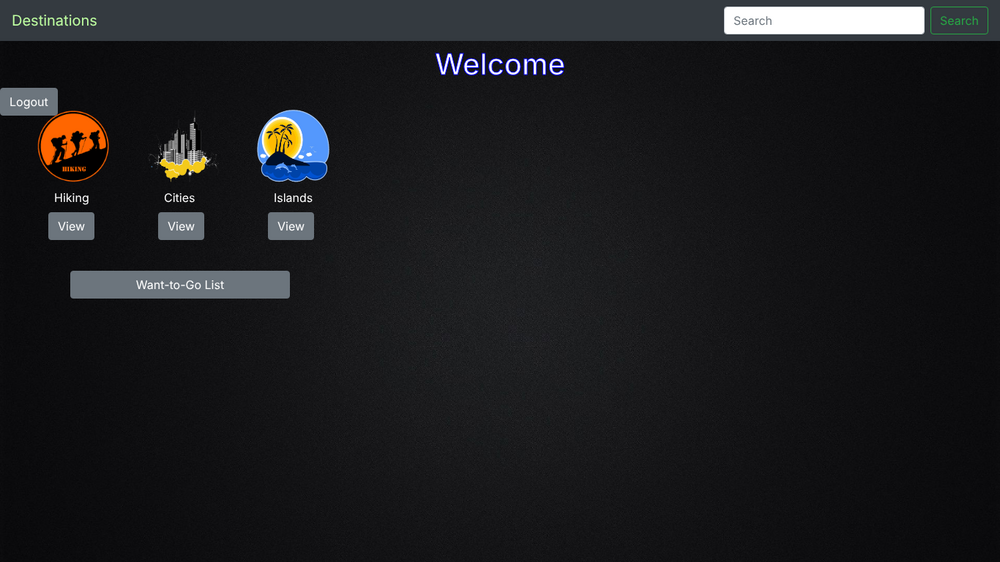
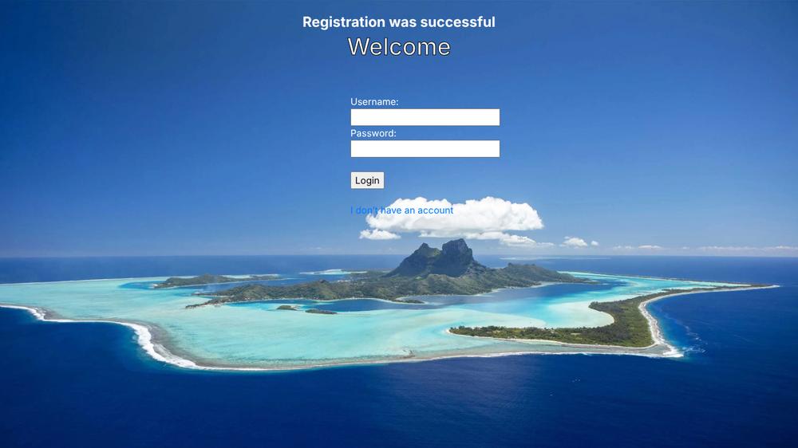
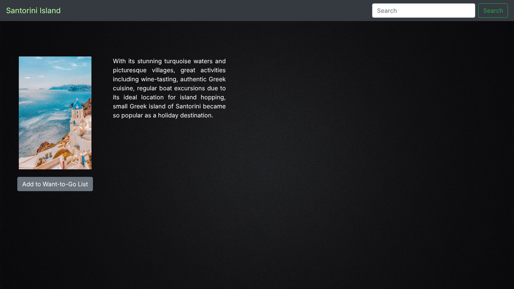
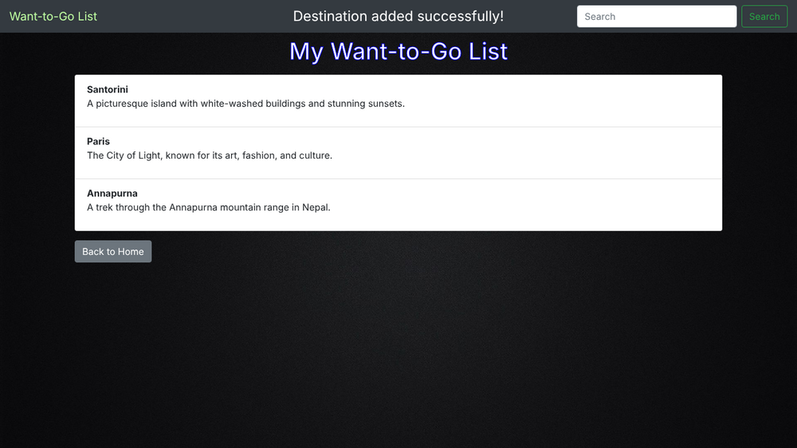
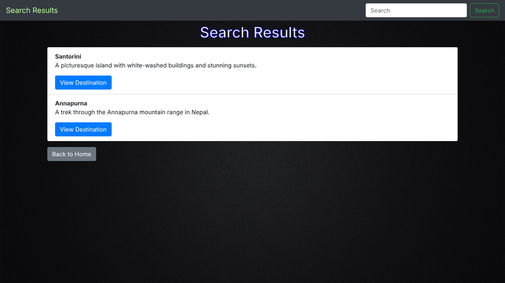
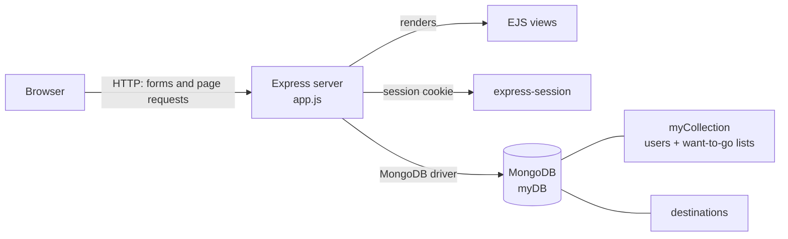

<div align="center">

# ✈️ Travel Website

**A client/server travel website built with Node.js, Express, EJS and MongoDB: users register, log in with their own session, browse destinations by category, keep a personal want-to-go list and search destinations by name.**

[](https://github.com/DanEhab/travel-website/actions/workflows/ci.yml)




</div>

---

## Features

| | |
|---|---|
| **Accounts** | Registration and login, with errors shown on the page for empty fields, taken usernames and wrong passwords. Users are stored in MongoDB. |
| **Sessions** | `express-session` gives every user their own session, so several users can be logged in at once without seeing each other's data. Every page except login and registration requires a login. |
| **Browse** | Three categories (Hiking, Cities, Islands) and six destination pages (Paris, Rome, Santorini, Bali, Inca Trail, Annapurna), each with a photo, a description and an embedded video. |
| **Want-to-go list** | Add a destination from its page. Adding it twice shows a message instead of a duplicate, and the list is saved in the user's MongoDB document. |
| **Search** | A search bar on every page. Matching is case-insensitive and on part of the name (for example *"an"* finds Santorini and Annapurna), and each result links to its page. |

<table>
  <tr>
    <td></td>
    <td></td>
  </tr>
  <tr>
    <td></td>
    <td></td>
  </tr>
</table>

---

## How it works



- **Server**: [`app.js`](app.js) defines all routes. An `isAuthenticated` middleware protects every page and redirects to `/login` when there is no session.
- **Views**: one EJS template per page in [`views/`](views). The server passes data (search results, the want-to-go list, messages) into the templates.
- **Database**: the official MongoDB Node.js driver (no Mongoose, as the course required). Users and their want-to-go lists live in `myCollection`, and destinations in `destinations`. Search uses a case-insensitive regular expression on the destination name.

---

## Run it

You need **Node.js 18+** and **MongoDB** running on `localhost:27017`.

```console
$ git clone https://github.com/DanEhab/travel-website.git
$ cd travel-website
$ npm install
$ npm run seed      # loads the six destinations into MongoDB
$ npm start         # http://localhost:3000
```

`MONGO_URI`, `PORT` and `SESSION_SECRET` can be set as environment variables.

## Tests

[`test/smoke.test.js`](test/smoke.test.js) drives the running website over HTTP. It checks the login protection, registration and login errors, every page, adding to the want-to-go list (including duplicates), partial and case-insensitive search, "Destination not Found" and logout. GitHub Actions runs it on every push against a real MongoDB.

```console
$ npm test
✔ pages require a login
✔ registration validates its input
✔ login
✔ category and destination pages
✔ want-to-go list
✔ search
✔ logout
```

---

## After the submission

The first commit is the project exactly as submitted in December 2024. Reviewing it later showed a few problems, which the second commit fixes:

- The home page was reachable without logging in, because an earlier route for `/` skipped the login check.
- Registration accepted empty usernames and passwords.
- Errors and "not found" messages were plain-text pages instead of messages inside the site.
- Bootstrap was loaded from an external CDN. It is now served from `node_modules`, so the site looks the same offline.

---

## Team & course

Built for **CSEN503 Introduction to Communication Networks**, German University in Cairo, Winter 2024.

**Team:** Daniel Ehab · Khaled Korayem · Yaseen Gadalla · Youssef · Youssef Yasser
